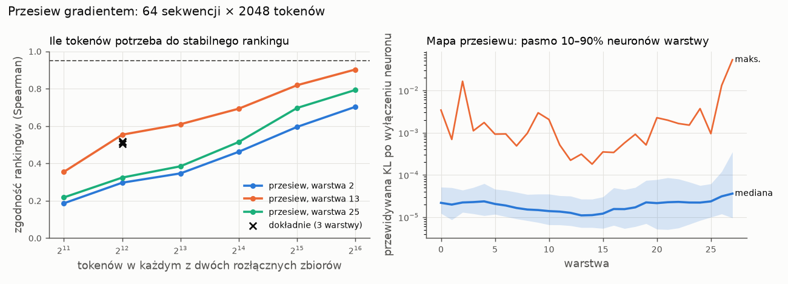

# Etap 2 — mapa wrażliwości wszystkich 86 016 neuronów

*2026-10-30 02:05 — Claude Opus 5.5*

## Co masz zrobić

Przeczytaj i odpowiedz na **K17** i **K18** w `AGENTS/phases/phase-pomysl/agents-issues-3.md` (czy akceptujesz mapę z przesiewu oraz co zrobić z tym, że tekst i kod mają różne ważne neurony). Jeśli zgadzasz się z rekomendacjami, wystarczy „rek”.

---

## 1. Jak policzona

Dlaczego tak, a nie „wszystko dokładnie”: `etap-1-pilot.md`, rozdz. 2.5 i 3. W skrócie: 4096 tokenów daje ranking o wiarygodności ~0,5, a przesiew jest ~1000× tańszy, więc można go policzyć na dużo większej liczbie tokenów.

**Przesiew (Fisher)** dla każdego neuronu $j$ każdej warstwy:

$$
\widehat{\mathrm{KL}}_j(\delta = -1) = \frac{1}{2\,S\,T} \sum_{\text{sekwencje}} \sum_{s=1}^{S} \Bigg( \sum_{t} \frac{\partial \log p\big(y^{(s)}\big)}{\partial a_{j,t}}\; a_{j,t} \Bigg)^2 .
$$

Słownie:
1. dla każdej sekwencji losujemy z samego modelu $S$ alternatywnych ciągów następnych tokenów $y^{(s)}$;
2. liczymy, jak bardzo logarytm ich prawdopodobieństwa zmieniłby się po przeskalowaniu aktywacji $a_j$ neuronu $j$ (gradient razy aktywacja, zsumowane po pozycjach $t$);
3. średni kwadrat tej zmiany, podzielony przez $2T$, przybliża KL po wyłączeniu neuronu.

Jeden przebieg w przód i $S$ przebiegów wstecz daje wynik dla wszystkich 86 016 neuronów naraz.

| Ustawienie | Wartość |
|---|---|
| tokeny | 64 sekwencje × 2048 = **131 072** (48 sekwencji C4 + 16 kodu) |
| próbki $S$ | 64 na sekwencję |
| precyzja | float32, bez TF32 |
| czas | **21 min** |

Wynik zapisany per sekwencja (`results/phase2/stage2/fisher-per-sequence-64.pt`), dzięki czemu dało się sprawdzić powtarzalność. Mapa (średnia z 64 sekwencji): `results/phase2/stage2/fisher-map.pt`.

## 2. Czy przesiew zgadza się z pomiarem dokładnym

Na tych samych 4096 tokenach co pilot (3 warstwy, wszystkie neurony):

| Warstwa | Spearman | wspólne „top 10%” | suma przesiew / suma dokładnie |
|---|---|---|---|
| 2 | 0,96 | 84% | 1,44 |
| 13 | 0,98 | 87% | 1,00 |
| 25 | 0,98 | 87% | 0,96 |

Na **drugim** zbiorze 4096 tokenów (166 neuronów na warstwę): 0,94 / 0,98 / 0,96. Przesiew odtwarza więc pomiar dokładny prawie idealnie, gdy oba liczone są na tych samych tokenach. Wyjątek to kilka masywnych neuronów warstwy 2: ich skutek jest przeszacowany 1,7–4×, stąd suma 1,44.

## 3. Ile tokenów potrzeba do stabilnego rankingu

Lewy wykres: losujemy dwa rozłączne zbiory po $k$ sekwencji i porównujemy rankingi neuronów (średnia z 8 losowań). Krzyżyki to pomiar dokładny z pilota.

| Tokenów w każdym zbiorze | 2048 | 4096 | 8192 | 16 384 | 32 768 | 65 536 |
|---|---|---|---|---|---|---|
| zgodność (średnio po 28 warstwach) | 0,30 | 0,47 | 0,52 | 0,62 | 0,75 | 0,85 |

Dwie połówki pełnej mapy (po 65 536 tokenów) zgadzają się w 0,66–0,93, najlepiej w środkowych warstwach 12–20 (0,87–0,93), a najsłabiej w warstwach 2–3 i 24–25 (0,66–0,68). Z tego, jak zgodność rośnie z liczbą tokenów (wzór Spearmana–Browna $r_{2k} = \frac{2 r_k}{1 + r_k}$), cała mapa ze 131 tys. tokenów ma wiarygodność około **0,89** (średnio; od 0,80 w warstwach 2, 3 i 25 do 0,96 w warstwach 16–17).

**Co to znaczy w praktyce:** ranking „środka” rozkładu (neurony o zbliżonej ważności) nadal zależy od tekstu. Ranking skrajności (najważniejsze i najmniej ważne neurony) jest stabilny. Przy wycinaniu 5–40% neuronów decydują właśnie skrajności i okolice progu.

## 4. Tekst a kod: inne ważne neurony

| | warstwy 0–27 (zakres) |
|---|---|
| ranking z 48 sekwencji C4 vs ranking z 16 sekwencji kodu | od −0,15 do 0,23 |
| dwie porcje C4 po 16 sekwencji (ta sama wielkość co kod) | 0,74–0,94 |

Gdyby różnica wynikała tylko z szumu, tekst i kod zgadzałyby się mniej więcej tak jak dwie porcje tekstu. Zgadzają się jednak **prawie wcale**. Neurony ważne dla kodu to w dużej mierze inne neurony niż ważne dla tekstu. Mapa z mieszanki 75/25 jest kompromisem; pytanie **K18**.

## 5. Mapa: jak wrażliwe są warstwy

Prawy wykres: mediana, pasmo 10–90% i maksimum przewidywanej KL po wyłączeniu jednego neuronu.

| Warstwy | mediana KL | suma KL po neuronach | uwagi |
|---|---|---|---|
| 0–5 | $2{,}0$–$2{,}4 \cdot 10^{-5}$ | 0,08–0,15 | warstwa 2: maksimum $1{,}6 \cdot 10^{-2}$ (masywne neurony #55, #1489, #128) |
| 6–16 | $1{,}1$–$1{,}9 \cdot 10^{-5}$ | **0,045–0,08** | najmniej wrażliwe: 13 i 14 (suma 0,045) |
| 17–26 | $1{,}6$–$3{,}1 \cdot 10^{-5}$ | 0,07–0,21 | |
| 27 (ostatnia) | $3{,}6 \cdot 10^{-5}$ | **0,76** | maksimum $5{,}3 \cdot 10^{-2}$; tu jest 53 z 75 neuronów „krytycznych” |

„Suma KL po neuronach” nie jest skutkiem wycięcia całej warstwy (skutki nie dodają się), ale dobrze porównuje warstwy między sobą. Środek modelu jest najmniej wrażliwy na pojedyncze neurony, a ostatnia warstwa jest ~17× bardziej wrażliwa niż warstwa 13.

## 6. Pomiar dokładny 10% najważniejszych + 5% losowych (kontrola)

Liczy się po etapie 4 (kolejka GPU), ~2 h. Wynik dopiszę w tym miejscu jako nowy wpis.

## 7. Pliki

- `results/phase2/stage2/fisher-per-sequence-64.pt` (64 × 28 × 3072), `fisher-map.pt`, `fisher-summary.json`;
- kod: `scripts/phase2_stage2_fisher_map.py`, `scripts/phase2_stage2_fisher_analysis.py`, `scripts/phase2_stage2_full_map.py` (pomiar dokładny), `src/qwen_compression/importance.py`.

*2026-10-30 02:05 — Claude Opus 5.5*
